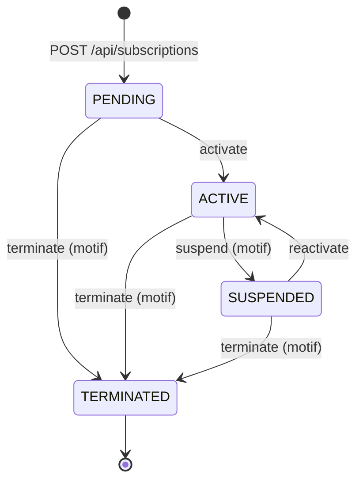

# Subscription API

[](https://github.com/Ultimatu/subscription-test-api/actions/workflows/ci.yml)

API REST de gestion des clients, du catalogue d'offres et des souscriptions d'un fournisseur d'accès (fibre, satellite, box 4G), réalisée avec Spring Boot 3 et PostgreSQL dans le cadre d'un test technique.

## Sommaire

1. [Description du projet](#1-description-du-projet)
2. [Prérequis](#2-prérequis)
3. [Démarrage rapide](#3-démarrage-rapide)
4. [Configuration de la base PostgreSQL](#4-configuration-de-la-base-postgresql)
5. [Lancement et tests](#5-lancement-et-tests)
6. [Architecture](#6-architecture)
7. [Endpoints](#7-endpoints)
8. [Transitions de statut d'une souscription](#8-transitions-de-statut-dune-souscription)
9. [Règles métier](#9-règles-métier)
10. [Erreurs](#10-erreurs)
11. [Sécurité](#11-sécurité)
12. [Collection Postman et scénario de bout en bout](#12-collection-postman-et-scénario-de-bout-en-bout)
13. [Limites et améliorations](#13-limites-et-améliorations)
14. [Documentation complémentaire](#14-documentation-complémentaire)
15. [Méthode de travail](#15-méthode-de-travail)

## 1. Description du projet

L'API permet de :

- gérer les **clients** : création, recherche, modification, suppression, synthèse de leurs souscriptions ;
- gérer le **catalogue d'offres** : création, modification du libellé et du prix, retrait du catalogue ;
- gérer les **souscriptions** d'un client à une offre et leur cycle de vie : PENDING → ACTIVE → SUSPENDED → TERMINATED ;
- consulter des **statistiques** : souscriptions actives et revenu par ville, répartition par technologie, décompte par statut sur une période.

Les 22 règles métier de l'énoncé sont appliquées, dans l'ordre de vérification imposé. Les 11 offres du catalogue sont chargées au démarrage.

Au-delà de l'énoncé, sans en modifier le contrat d'API (mêmes URLs, mêmes corps de requête, mêmes codes HTTP) :

| Ajout | Intérêt | Détail |
|---|---|---|
| Authentification JWT, rôles ADMIN et CONSEILLER | Savoir qui agit, restreindre les opérations sensibles | [ADR-0013](docs/adr/0013-securite.md) |
| Audit et historique des statuts | Chaque modification porte son auteur et sa date ; chaque changement de statut est conservé avec son motif | [ADR-0004](docs/adr/0004-audit-et-historique.md) |
| Suppression logique | Un client ou une souscription supprimés disparaissent de l'API mais restent en base | [ADR-0005](docs/adr/0005-suppression-logique.md) |
| Catalogue des technologies | Ajouter une technologie ne demande ni code ni déploiement | [ADR-0006](docs/adr/0006-technologies-donnees-de-reference.md) |
| Erreurs au format Problem Details (RFC 9457) | Format standard, avec un `code` stable exploitable par un client de l'API | [ADR-0007](docs/adr/0007-format-des-erreurs.md) |
| Traçabilité par `X-Request-Id` | Retrouver dans les logs toutes les lignes d'une requête | [ADR-0008](docs/adr/0008-tracabilite-des-requetes.md) |
| Recherche insensible aux accents | `kone` trouve `Koné`, `bouake` trouve `Bouaké` | [ADR-0017](docs/adr/0017-recherche-insensible-aux-accents.md) |
| Attestation PDF | Le conseiller remet au client une attestation de souscription, ou de résiliation, générée à la demande | [ADR-0019](docs/adr/0019-attestation-pdf.md) |
| Prix figé à la souscription | Une hausse du catalogue ne change ni le prix des souscriptions existantes ni le revenu calculé | [ADR-0018](docs/adr/0018-prix-fige-a-la-souscription.md) |
| Accès concurrents maîtrisés | Deux souscriptions simultanées ne peuvent pas contourner la règle 14 | [ADR-0014](docs/adr/0014-souscriptions-numerotation-et-concurrence.md) |
| Documentation OpenAPI (Swagger UI) | Tester l'API depuis le navigateur | `/swagger-ui.html` |
| Schéma versionné (Flyway), contraintes doublées en base | Les règles tiennent même en cas d'accès concurrent ou d'écriture directe en base | [ADR-0002](docs/adr/0002-schema-versionne-flyway.md) |
| Couverture mesurée (JaCoCo), architecture vérifiée (ArchUnit) | Le build échoue si la couverture baisse ou si une dépendance va dans le mauvais sens | [ADR-0016](docs/adr/0016-couverture-de-code.md) |

**Stack** : Java 17, Spring Boot 3.5 (Web, Data JPA, Validation, Security, OAuth2 Resource Server, Actuator), PostgreSQL, Flyway, springdoc-openapi, Thymeleaf et openhtmltopdf (PDF), Lombok. Tests : JUnit 5, AssertJ, Mockito, Spring Security Test, ArchUnit, JaCoCo.

## 2. Prérequis

| Outil | Version | Remarque |
|---|---|---|
| JDK | 17 | Testé avec OpenJDK 17.0.18 |
| Maven | 3.6.3 ou plus récent | Facultatif : le dépôt contient le wrapper Maven (`./mvnw`), qui télécharge la bonne version |
| PostgreSQL | 13 ou plus récent | Testé avec PostgreSQL 16. Le module *contrib* doit être installé (extension `unaccent`) : il l'est par défaut avec Homebrew, l'installeur Windows et l'image Docker officielle ; sous Debian ou Ubuntu, c'est le paquet `postgresql-contrib` |

Docker est facultatif : il peut fournir PostgreSQL à la place d'une installation locale (voir ci-dessous).

## 3. Démarrage rapide

**Avec PostgreSQL installé**

```bash
# 1. Créer l'utilisateur et la base (une seule fois), avec un super-utilisateur PostgreSQL
#    (avec Homebrew, c'est l'utilisateur du système : retirer « -U postgres »)
psql -U postgres -c "CREATE USER subscription_user WITH PASSWORD 'subscription_pwd';"
psql -U postgres -c "CREATE DATABASE subscription_db OWNER subscription_user;"

# 2. Lancer l'application (Flyway crée le schéma et charge le catalogue au démarrage)
mvn spring-boot:run
```

**Ou avec Docker**, sans rien installer d'autre que le JDK

```bash
docker compose up -d      # PostgreSQL 16, avec la base et l'utilisateur de application.yml
mvn spring-boot:run
```

Si un PostgreSQL local occupe déjà le port 5432 : `POSTGRES_PORT=5433 docker compose up -d`, puis `SPRING_DATASOURCE_URL=jdbc:postgresql://localhost:5433/subscription_db mvn spring-boot:run`.

L'application écoute sur `http://localhost:8080` :

| Adresse | Contenu |
|---|---|
| `http://localhost:8080/swagger-ui.html` | Documentation interactive (bouton « Authorize » pour saisir le jeton) |
| `http://localhost:8080/v3/api-docs` | Spécification OpenAPI (JSON) |
| `http://localhost:8080/actuator/health` | État de l'application |

Toutes les routes `/api/**`, sauf la connexion, demandent un jeton, obtenu avec l'un des deux comptes de démonstration :

| Compte | Mot de passe | Droits |
|---|---|---|
| `admin` | `Admin@2026` | Tous les droits |
| `conseiller` | `Conseiller@2026` | Clients et souscriptions, sans suppression, catalogue ni statistiques |

```bash
curl -X POST http://localhost:8080/api/auth/login \
     -H 'Content-Type: application/json' \
     -d '{ "username": "admin", "password": "Admin@2026" }'
```

La [collection Postman](#12-collection-postman-et-scénario-de-bout-en-bout) se connecte toute seule. Pour tester l'API sans jeton, la sécurité peut être désactivée : `APP_SECURITY_ENABLED=false mvn spring-boot:run`.

## 4. Configuration de la base PostgreSQL

La configuration se trouve dans `src/main/resources/application.yml` :

```yaml
spring:
  datasource:
    url: jdbc:postgresql://localhost:5432/subscription_db
    username: subscription_user
    password: subscription_pwd
  jpa:
    hibernate:
      ddl-auto: validate   # Hibernate vérifie le schéma, il ne le modifie jamais
    open-in-view: false
```

- **Schéma** : il est créé et mis à jour par **Flyway** au démarrage, à partir des migrations de `src/main/resources/db/migration` (V1 à V9). La migration V2 charge les 11 offres de l'énoncé, avec leurs libellés sans accents ; la migration V8 crée les deux comptes de démonstration. Le schéma, ses contraintes et ses index sont décrits dans [docs/base-de-donnees.md](docs/base-de-donnees.md).
- **Droits nécessaires** : l'utilisateur doit être propriétaire de la base, pour que Flyway puisse créer les tables, le schéma des tests et l'extension `unaccent` (extension de confiance, qui ne demande pas de droits de super-utilisateur).
- **Autre environnement** : les valeurs se remplacent par variables d'environnement, sans modifier le fichier ([ADR-0003](docs/adr/0003-configuration.md)) :

  | Variable | Rôle |
  |---|---|
  | `SPRING_DATASOURCE_URL`, `SPRING_DATASOURCE_USERNAME`, `SPRING_DATASOURCE_PASSWORD` | Connexion à la base |
  | `APP_SECURITY_JWT_SECRET` | Clé de signature des jetons (256 bits en Base64) ; obligatoire hors développement |
  | `APP_SECURITY_ENABLED` | `false` pour désactiver l'authentification |
  | `SERVER_PORT` | Port HTTP (8080 par défaut) |

- **Tests** : ils utilisent la même base, dans un schéma séparé `test` que Flyway crée et migre automatiquement (`src/test/resources/config/application.yml`). Les données saisies via l'application ne perturbent pas les tests, et il n'y a pas de seconde base à créer.

## 5. Lancement et tests

PostgreSQL doit être démarré, pour l'application comme pour les tests.

| Commande | Effet |
|---|---|
| `mvn spring-boot:run` | Lance l'application sur le port 8080 |
| `mvn test` | Exécute les 284 tests et produit le rapport de couverture `target/site/jacoco/index.html` |
| `mvn verify` | Idem, puis fait échouer le build sous 90 % de lignes ou 75 % de branches couvertes |

Sans Maven installé, remplacer `mvn` par `./mvnw` (`mvnw.cmd` sous Windows).

**Intégration continue** : à chaque push, GitHub Actions ([`.github/workflows/ci.yml`](.github/workflows/ci.yml)) lance `mvn verify` sur une base PostgreSQL 16, puis démarre l'application et rejoue la collection Postman avec Newman. Le rapport de couverture est conservé comme artefact de l'exécution.

**Couverture** (mesurée le 15/10/2026) :

| Périmètre | Tests | Lignes | Branches |
|---|---|---|---|
| Tous les tests (`mvn test`) | 284 | 98,6 % | 81,6 % |
| Tests unitaires seuls, sans base de données | 228 | 67,9 % | 49,8 % |

Les 60 % de couverture demandés par l'énoncé sont donc atteints par les seuls tests unitaires. Chaque couche est testée au niveau qui lui correspond ([ADR-0010](docs/adr/0010-strategie-de-tests.md)) :

| Couche | Type de test | Exemples |
|---|---|---|
| Domaine | Unitaire, Java pur | `SubscriptionTest` confronte les 16 combinaisons statut × opération au tableau de l'énoncé ; `SubscriptionEligibilityTest` vérifie l'ordre de la règle 15 |
| Services | Unitaire, ports simulés avec Mockito | Ressources introuvables, verrouillage du client, numérotation, aucun numéro consommé quand une règle est enfreinte |
| Web | Slice `@WebMvcTest` | Codes HTTP, validation, format des erreurs |
| Persistance | Intégration sur PostgreSQL, annulée en fin de test | Index uniques partiels, recherche, statistiques |
| Sécurité | Contexte complet, vrais jetons | Matrice des droits, jetons expirés ou falsifiés |
| Architecture | ArchUnit | Le domaine ne dépend d'aucun framework |

## 6. Architecture

### Choix : architecture hexagonale

L'API ne gère que trois entités, mais sa complexité est surtout métier : 22 règles, un cycle de vie avec des transitions interdites, un ordre de vérification imposé. L'**architecture hexagonale** (ports et adaptateurs) isole ces règles de la technique : elles se testent en Java pur, en quelques millisecondes, sans base de données ni HTTP.

Elle a un coût : plus de classes qu'une architecture en couches classique, et une duplication assumée entre le modèle du domaine et l'entité JPA. Sur un simple CRUD, elle serait surdimensionnée. Elle est appliquée ici de façon pragmatique, sans tout découper : un port d'entrée par agrégat plutôt qu'un par cas d'usage, et la pagination de Spring Data acceptée dans la couche application. Le détail et les alternatives sont dans l'[ADR-0001](docs/adr/0001-architecture-hexagonale.md).

Les dépendances pointent toujours vers le centre : `infrastructure` → `application` → `domain`. Le test `ArchitectureTest` (ArchUnit) le vérifie à chaque build.

### Arborescence

```
subscription-api/
├── docs/                           décisions d'architecture (ADR), interprétations, schéma de la base
├── postman/                        collection Postman
├── src/main/java/ci/orange/subscription/
│   ├── domain/                     le métier, en Java pur
│   │   ├── client/                 Client, ClientStatus
│   │   ├── offer/                  Offer
│   │   ├── technology/             Technology
│   │   ├── subscription/           Subscription, SubscriptionTransition, SubscriptionEligibility…
│   │   ├── exception/              exceptions métier et leurs codes (DomainErrorCode)
│   │   └── common/                 validations et informations d'audit partagées
│   ├── application/                les cas d'usage
│   │   ├── port/in/                ce que l'application sait faire (ClientUseCases…), commandes, vues
│   │   ├── port/out/               ce dont elle a besoin (ClientRepository, SubscriptionNumberSequences…)
│   │   └── service/                implémentation des cas d'usage, transactions, ordre des règles
│   └── infrastructure/             les adaptateurs
│       ├── web/                    controllers REST, DTO, gestion des erreurs, traçabilité des requêtes
│       ├── persistence/            entités JPA, repositories Spring Data, implémentation des ports de sortie
│       ├── security/               JWT, comptes utilisateurs, matrice des droits
│       ├── document/               attestation PDF (gabarit Thymeleaf converti par openhtmltopdf)
│       └── config/                 horloge, préfixe /api, OpenAPI
├── src/main/resources/
│   ├── application.yml
│   ├── db/migration/               migrations Flyway V1 à V9
│   └── templates/documents/        gabarit HTML de l'attestation
└── src/test/java/                  tests, dans la même arborescence
```

### Rôle de chaque couche

| Couche | Rôle |
|---|---|
| `domain` | Modèles riches qui protègent leurs invariants : `Client.create` force le statut ACTIVE, `subscription.suspend(reason)` refuse une transition interdite et enregistre le changement de statut. Aucun import Spring, JPA ou Jackson : ne dépend de rien. |
| `application` | Cas d'usage : charge les objets métier par les ports de sortie, applique les règles dans l'ordre imposé, enregistre le résultat. Porte les transactions (`@Transactional`). Ne dépend que du domaine. |
| `infrastructure.web` | Traduit HTTP en appels aux ports d'entrée : validation des corps de requête (Bean Validation), conversion DTO ↔ modèle, conversion des exceptions en réponses Problem Details, identifiant de requête. |
| `infrastructure.persistence` | Implémente les ports de sortie avec JPA. Les entités JPA (`ClientEntity`…) sont distinctes des modèles du domaine, reliées par un mapping manuel. |
| `infrastructure.security` | Émission et vérification des jetons, comptes utilisateurs, droits par rôle. |
| `infrastructure.document` | Mise en page de l'attestation : gabarit HTML et CSS rendu en PDF. |
| `infrastructure.config` | Assemblage : horloge (fuseau Africa/Abidjan), préfixe `/api`, description OpenAPI. |

Les adaptateurs de `infrastructure` dépendent de `application` et de `domain`, jamais l'inverse : le métier ignore qu'il est exposé en HTTP et stocké dans PostgreSQL.

### Parcours d'une requête

Exemple : `POST /api/subscriptions/suspend` avec `{ "subscriptionId": 1, "reason": "Impayé" }`.

1. `RequestTracingFilter` reprend l'en-tête `X-Request-Id` ou en génère un, et le place dans chaque ligne de log.
2. Spring Security vérifie le jeton et le rôle.
3. `SubscriptionController` (web) valide le corps (`reason` non vide, pas de `nd`), puis appelle `SubscriptionUseCases.suspend`.
4. `SubscriptionService` (application) charge la souscription par le port `SubscriptionRepository`, puis appelle `subscription.suspend("Impayé")`.
5. `Subscription` (domaine) vérifie que la transition ACTIVE → SUSPENDED est permise et enregistre le changement, avec son motif.
6. `SubscriptionPersistenceAdapter` (persistance) enregistre la souscription et ajoute une ligne à l'historique des statuts.
7. Le controller renvoie le détail de la souscription. En cas d'erreur, `GlobalExceptionHandler` produit la réponse Problem Details (ici, 409 si la souscription n'est pas ACTIVE).

## 7. Endpoints

Toutes les routes métier sont préfixées par `/api`. **Rôles** : *Conseiller* signifie accessible aux rôles CONSEILLER et ADMIN ; *Admin*, au seul rôle ADMIN. Les listes sont paginées (`page` à partir de 0, `size` 20 par défaut et 100 au maximum, `sort=champ,asc|desc`).

### Clients

| Méthode | URL | Paramètres | Description | Succès | Rôle |
|---|---|---|---|---|---|
| POST | `/api/clients` | Corps : `firstName`, `lastName`, `email`, `phoneNumberClient`, `city` | Créer un client | 201 | Conseiller |
| GET | `/api/clients` | `city`, `status`, `search`, `page`, `size`, `sort` | Lister les clients | 200 | Conseiller |
| GET | `/api/clients/{id}` | | Détail d'un client | 200 | Conseiller |
| PUT | `/api/clients/{id}` | Corps : `firstName`, `lastName`, `phoneNumberClient`, `city`, `status` | Modifier un client | 200 | Conseiller |
| DELETE | `/api/clients/{id}` | | Supprimer un client | 204 | Admin |
| GET | `/api/clients/{id}/summary` | | Nombre de souscriptions par statut et revenu mensuel total | 200 | Conseiller |
| GET | `/api/clients/{clientId}/subscriptions` | `page`, `size`, `sort` | Souscriptions d'un client | 200 | Conseiller |

### Offres

| Méthode | URL | Paramètres | Description | Succès | Rôle |
|---|---|---|---|---|---|
| POST | `/api/offers` | Corps : `code`, `label`, `technology`, `monthlyPrice` | Créer une offre | 201 | Admin |
| GET | `/api/offers` | `technology`, `active`, `page`, `size`, `sort` | Lister les offres | 200 | Conseiller |
| GET | `/api/offers/{id}` | | Détail d'une offre | 200 | Conseiller |
| PUT | `/api/offers/{id}` | Corps : `label`, `monthlyPrice` | Modifier une offre | 200 | Admin |
| PATCH | `/api/offers/{id}/deactivate` | | Retirer une offre du catalogue | 200 | Admin |

### Souscriptions

| Méthode | URL | Paramètres | Description | Succès | Rôle |
|---|---|---|---|---|---|
| POST | `/api/subscriptions` | Corps : `clientId`, `offerId`, `startDate` | Souscrire à une offre | 201 | Conseiller |
| GET | `/api/subscriptions` | `status`, `technology`, `city`, `nd`, `startDateFrom`, `startDateTo`, `page`, `size`, `sort` | Recherche globale | 200 | Conseiller |
| GET | `/api/subscriptions/{id}` | | Détail, avec le client, l'offre et l'historique des statuts | 200 | Conseiller |
| GET | `/api/subscriptions/by-nd/{nd}` | | Retrouver une souscription par son ND | 200 | Conseiller |
| POST | `/api/subscriptions/activate` | Corps : `subscriptionId` | PENDING → ACTIVE | 200 | Conseiller |
| POST | `/api/subscriptions/suspend` | Corps : `subscriptionId`, `reason` | ACTIVE → SUSPENDED | 200 | Conseiller |
| POST | `/api/subscriptions/reactivate` | Corps : `subscriptionId` | SUSPENDED → ACTIVE | 200 | Conseiller |
| POST | `/api/subscriptions/terminate` | Corps : `subscriptionId`, `reason` | → TERMINATED | 200 | Conseiller |
| DELETE | `/api/subscriptions/{id}` | | Supprimer une souscription PENDING | 204 | Admin |

### Statistiques

| Méthode | URL | Paramètres | Description | Succès | Rôle |
|---|---|---|---|---|---|
| GET | `/api/stats/subscriptions-by-city` | | Souscriptions actives et revenu mensuel par ville | 200 | Admin |
| GET | `/api/stats/subscriptions-by-technology` | | Répartition des souscriptions actives par technologie | 200 | Admin |
| GET | `/api/stats/subscriptions-by-status` | `from`, `to`, `basedOn` (facultatif) | Nombre de souscriptions par statut sur une période | 200 | Admin |

`basedOn` précise quelle date doit tomber dans la période : `CREATION_DATE` (par défaut), `START_DATE` ou `STATUS_CHANGE` (changements de statut survenus pendant la période, d'après l'historique).

### Hors énoncé

| Méthode | URL | Description | Succès | Rôle |
|---|---|---|---|---|
| POST | `/api/auth/login` | Obtenir un jeton (`username`, `password`) | 200 | Public |
| GET | `/api/technologies` | Lister les technologies | 200 | Conseiller |
| GET | `/api/technologies/{code}` | Détail d'une technologie | 200 | Conseiller |
| GET | `/api/subscriptions/{id}/attestation` | Télécharger l'attestation de souscription ou de résiliation (PDF) | 200 | Conseiller |
| POST | `/api/technologies` | Ajouter une technologie (`code`, `label`) | 201 | Admin |

Le détail de chaque endpoint (corps, réponses, erreurs possibles) est consultable dans Swagger UI.

## 8. Transitions de statut d'une souscription



| Statut de départ | Statut d'arrivée | Opération |
|---|---|---|
| — | PENDING | `POST /api/subscriptions` |
| PENDING | ACTIVE | `POST /api/subscriptions/activate` |
| PENDING | TERMINATED | `POST /api/subscriptions/terminate` |
| ACTIVE | SUSPENDED | `POST /api/subscriptions/suspend` |
| ACTIVE | TERMINATED | `POST /api/subscriptions/terminate` |
| SUSPENDED | ACTIVE | `POST /api/subscriptions/reactivate` |
| SUSPENDED | TERMINATED | `POST /api/subscriptions/terminate` |
| TERMINATED | — (état final) | aucune |

- La suspension et la résiliation exigent un motif, conservé dans l'historique des statuts.
- La résiliation renseigne la date de fin à la date du jour.
- Seule une souscription PENDING peut être supprimée (`DELETE /api/subscriptions/{id}`).
- Toute autre transition est refusée par une **409**, qui indique le statut courant et le statut requis :

```json
{
  "type": "about:blank",
  "title": "Transition de statut interdite",
  "status": 409,
  "detail": "Opération ACTIVATE impossible : la souscription est au statut SUSPENDED, statut requis : PENDING",
  "instance": "/api/subscriptions/activate",
  "code": "INVALID_STATUS_TRANSITION",
  "timestamp": "2026-10-15T00:17:51.780604Z",
  "requestId": "e7ae7c6d-1a4a-4df8-a781-0dbed69616af",
  "currentStatus": "SUSPENDED",
  "requiredStatuses": ["PENDING"]
}
```

Dans le code, les transitions sont décrites par l'enum `SubscriptionTransition`, qui reprend ce tableau : une constante par opération, avec ses statuts de départ et son statut d'arrivée.

## 9. Règles métier

Chaque règle est appliquée dans le domaine ou dans les services ; les règles d'unicité et de format sont en plus garanties par des contraintes en base.

| Règle | Résumé | En cas de violation |
|---|---|---|
| 1 | Email unique, non modifiable | 409 `CLIENT_EMAIL_ALREADY_USED` ; 400 si `email` est envoyé dans le `PUT` |
| 2 | Téléphone : dix chiffres commençant par 01, 05 ou 07 | 400 `VALIDATION_ERROR` |
| 3 | Client créé ACTIVE, `status` ignoré à la création | — |
| 4 | Statut du client modifiable par le `PUT`, dans les deux sens | — |
| 5 | Pas de nouvelle souscription pour un client INACTIVE | 409 `CLIENT_INACTIVE` |
| 6 | Suppression refusée si une souscription est PENDING, ACTIVE ou SUSPENDED | 409 `CLIENT_HAS_ONGOING_SUBSCRIPTIONS` |
| 7 | Code d'offre unique et en majuscules | 409 `OFFER_CODE_ALREADY_USED` ; 400 `VALIDATION_ERROR` |
| 8 | Prix mensuel strictement positif | 400 `VALIDATION_ERROR` |
| 9 | Offre créée active ; désactivation uniquement par `PATCH` | 400 si `active` est envoyé dans le `PUT` |
| 10 | Code et technologie non modifiables | 400 si `code` ou `technology` sont envoyés dans le `PUT` |
| 11 | Une offre désactivée n'accepte plus de souscription | 409 `OFFER_INACTIVE` |
| 12 | Souscription pour un client ACTIVE et une offre active | 409 `CLIENT_INACTIVE`, `OFFER_INACTIVE` |
| 13 | Une souscription SUSPENDED bloque toute nouvelle souscription | 409 `CLIENT_HAS_SUSPENDED_SUBSCRIPTION` |
| 14 | Une seule souscription PENDING ou ACTIVE par technologie | 409 `TECHNOLOGY_ALREADY_SUBSCRIBED` |
| 15 | Ordre : client actif → offre active → blocage global → unicité par technologie | La première règle enfreinte, dans cet ordre |
| 16 | Référence `SUB-{ANNÉE}-{6 chiffres}` générée par le serveur | 400 si `reference` est envoyée |
| 17 | ND `27XXXXXXXX` unique, attribué par le serveur | — |
| 18 | ND jamais modifiable | 400 si `nd` est envoyé dans un corps |
| 19 | Date de début aujourd'hui ou plus tard | 400 `START_DATE_IN_PAST` |
| 20 | Motif obligatoire pour la suspension et la résiliation, conservé | 400 `VALIDATION_ERROR` |
| 21 | Résiliation définitive, date de fin à la date du jour | 409 `INVALID_STATUS_TRANSITION` sur toute opération ultérieure |
| 22 | Seule une souscription PENDING peut être supprimée | 409 `SUBSCRIPTION_NOT_DELETABLE` |

Les points sur lesquels l'énoncé laisse une marge d'interprétation sont recensés, avec le choix retenu, dans [docs/interpretations.md](docs/interpretations.md). Les principaux :

- l'unicité de l'email ne tient pas compte de la casse : l'email est enregistré en minuscules ;
- un code d'offre en minuscules est refusé, pas converti ;
- « la date du jour » est celle d'Abidjan, quel que soit le fuseau du serveur ;
- un client ou une offre introuvables donnent une 404, avant les règles métier ;
- la suppression d'un client supprime aussi ses souscriptions résiliées, de façon logique ;
- le revenu mensuel ne compte que les souscriptions ACTIVE, au prix figé au moment de la souscription.

## 10. Erreurs

Toutes les erreurs suivent le format **Problem Details** (RFC 9457), complété par :

- `code` : un identifiant stable en majuscules (ex. `CLIENT_EMAIL_ALREADY_USED`), sur lequel un client de l'API peut s'appuyer sans analyser le message ;
- `timestamp` et `requestId` : l'identifiant de la requête, également renvoyé dans l'en-tête `X-Request-Id` et présent dans chaque ligne de log ;
- `errors` : la liste des champs invalides, pour les erreurs de validation.

```json
{
  "type": "about:blank",
  "title": "Requête invalide",
  "status": 400,
  "detail": "Un ou plusieurs champs sont invalides",
  "instance": "/api/clients",
  "code": "VALIDATION_ERROR",
  "timestamp": "2026-10-15T00:17:51.972786Z",
  "requestId": "dc12694e-5f07-4c96-9796-40e20e9a2649",
  "errors": [
    { "field": "firstName", "message": "ne doit pas être vide" },
    { "field": "email", "message": "doit être une adresse électronique syntaxiquement correcte" },
    { "field": "phoneNumberClient", "message": "doit comporter dix chiffres et commencer par 01, 05 ou 07" }
  ]
}
```

| Statut | Signification |
|---|---|
| 400 | Données invalides (format, champ obligatoire, champ non modifiable, date passée) |
| 401 | Jeton absent, invalide ou expiré ; identifiants incorrects |
| 403 | Rôle insuffisant |
| 404 | Ressource introuvable |
| 409 | Règle métier enfreinte, transition interdite, modification concurrente |

Quand plusieurs problèmes se cumulent, les données invalides (400) sont signalées avant les conflits (409). Une erreur interne (500) ne révèle jamais de détail technique.

## 11. Sécurité

L'API est un outil de back-office : ce sont des conseillers et des administrateurs qui l'utilisent, pas les clients finaux.

- **Connexion** : `POST /api/auth/login` renvoie un jeton JWT signé, valable une heure, à transmettre dans l'en-tête `Authorization: Bearer <jeton>`.
- **Rôles** : CONSEILLER gère les clients et les souscriptions ; ADMIN a en plus la gestion du catalogue, les suppressions et les statistiques (matrice complète dans l'[ADR-0013](docs/adr/0013-securite.md)).
- **Mots de passe** : stockés sous forme d'empreinte BCrypt, jamais écrits dans les logs.
- **Audit** : l'auteur de chaque modification est le titulaire du jeton (`createdBy`, `updatedBy`, `changedBy` dans l'historique).
- **Désactivation** : `APP_SECURITY_ENABLED=false` ouvre toute l'API sans jeton, pour tester le contrat de l'énoncé tel quel. L'auteur enregistré est alors `anonymous`.

Les comptes de démonstration et la clé de signature de `application.yml` servent au développement local uniquement. En production, la clé est fournie par `APP_SECURITY_JWT_SECRET`, et l'émission des jetons serait confiée à un fournisseur d'identité (voir [Limites et améliorations](#13-limites-et-améliorations)).

## 12. Collection Postman et scénario de bout en bout

### Utilisation

1. Lancer l'application (`mvn spring-boot:run`).
2. Dans Postman, importer `postman/subscription-api.postman_collection.json`.
3. Cliquer sur *Run collection* : les 61 requêtes s'exécutent dans l'ordre et vérifient 118 assertions (codes HTTP, statuts, codes d'erreur).

La collection **se connecte toute seule** : avant chaque requête, elle obtient ou renouvelle les jetons de l'administrateur et du conseiller. Chaque requête utilise le jeton du rôle indiqué dans son nom (administrateur par défaut). Les données sont générées à chaque exécution : la collection peut être rejouée autant de fois que nécessaire. La variable de collection `baseUrl` vaut `http://localhost:8080`.

En ligne de commande, avec Node.js :

```bash
npx newman run postman/subscription-api.postman_collection.json
```

| Dossier | Contenu |
|---|---|
| 0 · Authentification | Connexion en administrateur et en conseiller |
| 1 · Scénario de bout en bout | Les 7 étapes de l'énoncé, puis la vérification de l'historique et l'attestation de résiliation |
| 2 · Règles métier | Les règles démontrées par leurs cas d'erreur, et les contrôles de droits (401, 403) |
| 3 · Clients | Tous les endpoints des clients |
| 4 · Offres | Tous les endpoints des offres |
| 5 · Technologies | Catalogue des technologies |
| 6 · Souscriptions | Détail, recherche par ND, recherche globale, liste par client, attestation, suppression |
| 7 · Statistiques | Les trois indicateurs |

La spécification OpenAPI (`http://localhost:8080/v3/api-docs`) peut aussi être importée dans Postman, qui génère alors une requête par endpoint, sans le scénario ni les vérifications.

### Scénario de bout en bout

Création client → offre → souscription → activation → suspension → réactivation → résiliation. Les réponses ci-dessous sont celles de l'application ; les dates d'audit sont abrégées.

**0. Connexion**, une fois par rôle (fait automatiquement par la collection)

```http
POST /api/auth/login
Content-Type: application/json

{ "username": "conseiller", "password": "Conseiller@2026" }
```

```json
200 OK
{ "accessToken": "eyJhbGciOiJIUzI1NiJ9…", "tokenType": "Bearer", "expiresIn": 3600, "roles": ["CONSEILLER"] }
```

**1. Création du client** (conseiller)

```http
POST /api/clients
Authorization: Bearer <jeton du conseiller>
Content-Type: application/json

{
  "firstName": "Awa",
  "lastName": "Koné",
  "email": "awa.kone@exemple.ci",
  "phoneNumberClient": "0701020304",
  "city": "Abidjan"
}
```

```json
201 Created
{
  "id": 14,
  "firstName": "Awa",
  "lastName": "Koné",
  "email": "awa.kone@exemple.ci",
  "phoneNumberClient": "0701020304",
  "city": "Abidjan",
  "status": "ACTIVE",
  "createdAt": "2026-10-15T00:17:51.148592Z",
  "createdBy": "conseiller",
  "updatedAt": "2026-10-15T00:17:51.148592Z",
  "updatedBy": "conseiller"
}
```

**2. Création de l'offre** (administrateur)

```http
POST /api/offers
Authorization: Bearer <jeton de l'administrateur>
Content-Type: application/json

{ "code": "FTTH-2000", "label": "Fibre Ultra 2 Gbps", "technology": "FTTH", "monthlyPrice": 200000 }
```

```json
201 Created
{ "id": 18, "code": "FTTH-2000", "label": "Fibre Ultra 2 Gbps", "technology": "FTTH", "monthlyPrice": 200000.00, "active": true, … }
```

**3. Souscription** (conseiller)

```http
POST /api/subscriptions
Authorization: Bearer <jeton du conseiller>
Content-Type: application/json

{ "clientId": 14, "offerId": 18, "startDate": "2026-10-15" }
```

```json
201 Created
{
  "id": 14,
  "reference": "SUB-2026-000001",
  "nd": "2700000001",
  "status": "PENDING",
  "technology": "FTTH",
  "monthlyPrice": 200000.00,
  "startDate": "2026-10-15",
  "endDate": null,
  "client": { "id": 14, "firstName": "Awa", "lastName": "Koné", "city": "Abidjan", "status": "ACTIVE" },
  "offer": { "id": 18, "code": "FTTH-2000", "label": "Fibre Ultra 2 Gbps", "monthlyPrice": 200000.00 },
  "createdAt": "2026-10-15T00:17:51.533815Z",
  "createdBy": "conseiller",
  "updatedAt": "2026-10-15T00:17:51.533815Z",
  "updatedBy": "conseiller",
  "history": [
    { "from": null, "to": "PENDING", "reason": null, "changedAt": "2026-10-15T00:17:51.540297Z", "changedBy": "conseiller" }
  ]
}
```

**4. Activation**, **5. Suspension**, **6. Réactivation** (conseiller) : l'identifiant de la souscription passe dans le corps, comme l'impose l'énoncé. Chaque appel renvoie `200 OK` et le détail de la souscription avec son nouveau statut.

```http
POST /api/subscriptions/activate
{ "subscriptionId": 14 }

POST /api/subscriptions/suspend
{ "subscriptionId": 14, "reason": "Impayé" }

POST /api/subscriptions/reactivate
{ "subscriptionId": 14 }
```

**7. Résiliation** (conseiller)

```http
POST /api/subscriptions/terminate
Authorization: Bearer <jeton du conseiller>
Content-Type: application/json

{ "subscriptionId": 14, "reason": "Déménagement" }
```

```json
200 OK
{
  "id": 14,
  "reference": "SUB-2026-000001",
  "nd": "2700000001",
  "status": "TERMINATED",
  "startDate": "2026-10-15",
  "endDate": "2026-10-15",
  …
  "history": [
    { "from": null,        "to": "PENDING",    "reason": null,           "changedBy": "conseiller", … },
    { "from": "PENDING",   "to": "ACTIVE",     "reason": null,           "changedBy": "conseiller", … },
    { "from": "ACTIVE",    "to": "SUSPENDED",  "reason": "Impayé",       "changedBy": "conseiller", … },
    { "from": "SUSPENDED", "to": "ACTIVE",     "reason": null,           "changedBy": "conseiller", … },
    { "from": "ACTIVE",    "to": "TERMINATED", "reason": "Déménagement", "changedBy": "conseiller", … }
  ]
}
```

**8. Attestation de résiliation** (conseiller) : `GET /api/subscriptions/14/attestation` renvoie le PDF, nommé `attestation-SUB-2026-000001.pdf`.

<p align="center"></p>

Le dossier « 2 · Règles métier » de la collection démontre ensuite les cas d'erreur : doublon d'email, souscription bloquée par une suspension (règles 13 et 15), unicité par technologie (règle 14), transition interdite, suppression refusée, droits insuffisants.

## 13. Limites et améliorations

### Extensions réalisées

Ces extensions sont celles que j'aurais inscrites dans cette section. Le délai laissé pour le test étant largement suffisant, elles ont été réalisées, au-delà de l'énoncé et sans modifier son contrat d'API :

| Extension | Détail |
|---|---|
| Prix mensuel figé à la souscription : une hausse du catalogue ne change ni le prix des souscriptions existantes ni le revenu calculé | [ADR-0018](docs/adr/0018-prix-fige-a-la-souscription.md) |
| Attestation de souscription ou de résiliation au format PDF, téléchargeable depuis l'API | [ADR-0019](docs/adr/0019-attestation-pdf.md) |

### Pistes restantes

Ce que j'aurais fait avec plus de temps, ou dans un contexte de production :

**API**

- **Versionner l'API** (`/api/v1`) : l'énoncé fixe des URLs sans version, conservées telles quelles. Le préfixe étant déclaré à un seul endroit, l'ajout d'une version ne toucherait qu'une ligne ([ADR-0009](docs/adr/0009-prefixe-api.md)).
- **Clés d'idempotence** sur les `POST` (en-tête `Idempotency-Key`), pour qu'un appel rejoué après une coupure réseau ne crée pas une seconde souscription.
- **Titres d'erreur traduits** pour les erreurs produites par Spring lui-même (405, 415…), qui restent en anglais.

**Métier**

- **Événements métier** à chaque changement de statut (activation, suspension, résiliation), publiés de façon fiable (*transactional outbox*) pour prévenir la facturation ou le provisionnement de la ligne.
- **Planification** : une souscription dont la date de début est future pourrait être activée automatiquement ce jour-là.

**Sécurité**

- **Fournisseur d'identité** (Keycloak, Azure AD…) : l'API ne ferait plus que vérifier les jetons, et la table des comptes disparaîtrait.
- **Jeton de rafraîchissement** et **révocation** des jetons ; aujourd'hui, il faut se reconnecter au bout d'une heure, et un jeton reste valable jusqu'à son expiration.
- **Limitation du débit** sur la connexion, contre les tentatives répétées de mots de passe.

**Données et performance**

- **Index trigrammes** (`pg_trgm`) pour les recherches partielles, qui parcourent aujourd'hui toute la table, et un index d'expression sur la ville sans accents ; le schéma actuel est dimensionné pour quelques dizaines de milliers de clients ([docs/base-de-donnees.md](docs/base-de-donnees.md#pour-de-plus-gros-volumes)).
- **Cache** du catalogue d'offres et de technologies, qui change rarement.
- **Documents en masse** (relevés mensuels de tous les clients, par exemple) : une file de traitements (JobRunr sur PostgreSQL, ou un broker de messages). Inutile pour une attestation unitaire, générée en quelques dizaines de millisecondes ([ADR-0019](docs/adr/0019-attestation-pdf.md)).

**Tests et exploitation**

- **Testcontainers** : chaque exécution des tests aurait sa propre base PostgreSQL jetable. Écarté parce qu'il exige Docker, que l'énoncé ne prévoit pas ([ADR-0010](docs/adr/0010-strategie-de-tests.md)).
- **Séparer les tests unitaires et d'intégration** (Surefire / Failsafe), pour mesurer et exiger séparément la couverture de chacun ([ADR-0016](docs/adr/0016-couverture-de-code.md)).
- **Tests de contrat** de l'API générés depuis la spécification OpenAPI.
- **Image Docker de l'application**, pour la lancer avec sa base en une seule commande (le `compose.yaml` ne fournit aujourd'hui que PostgreSQL).
- **Observabilité** : métriques Prometheus (Micrometer), logs au format JSON, traces distribuées avec OpenTelemetry, en plus de l'identifiant de requête actuel.

## 14. Documentation complémentaire

| Document | Contenu |
|---|---|
| [docs/adr/](docs/adr/README.md) | Les 19 décisions d'architecture : contexte, décision, alternatives écartées et conséquences |
| [docs/interpretations.md](docs/interpretations.md) | Les points ambigus de l'énoncé et le choix retenu pour chacun |
| [docs/base-de-donnees.md](docs/base-de-donnees.md) | Tables et relations, contraintes reliées aux règles métier, index et requêtes qu'ils servent |
| Swagger UI (`/swagger-ui.html`) | Chaque endpoint, ses paramètres, ses réponses et ses erreurs |

## 15. Méthode de travail

- **Historique Git** : un commit par étape logique, au format *Conventional Commits* (`feat:`, `fix:`, `docs:`, `test:`…).
- **Documentation au fil de l'eau** : chaque décision structurante a été consignée dans une ADR au moment où elle a été prise, et chaque interprétation de l'énoncé dans `docs/interpretations.md`.
- **Usage de l'IA** : ce projet a été réalisé avec l'aide d'un assistant IA. Les choix d'architecture, de conception et d'interprétation ont été discutés et validés un à un, et sont justifiés dans les ADR.

---

Souleymane Tonde
