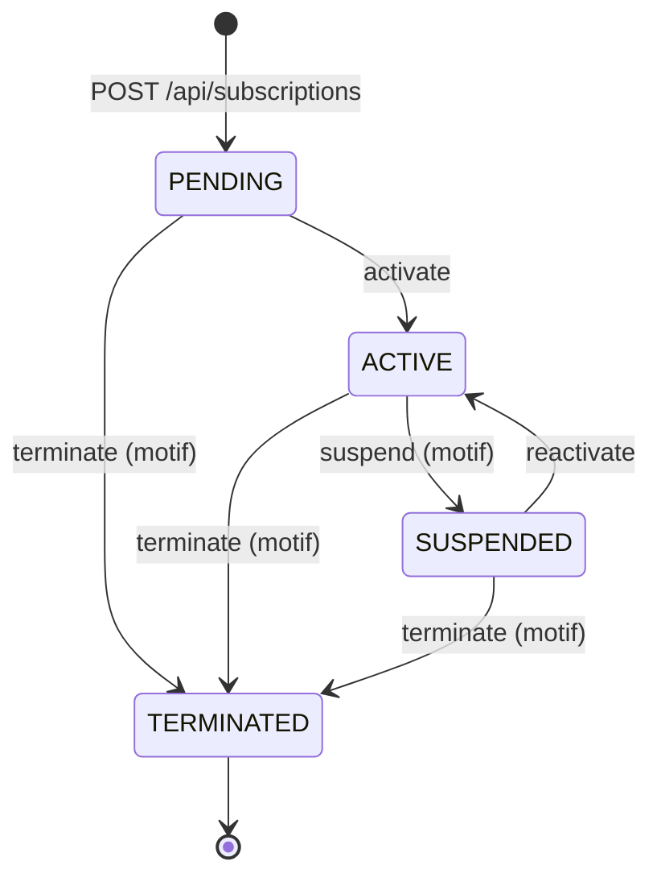
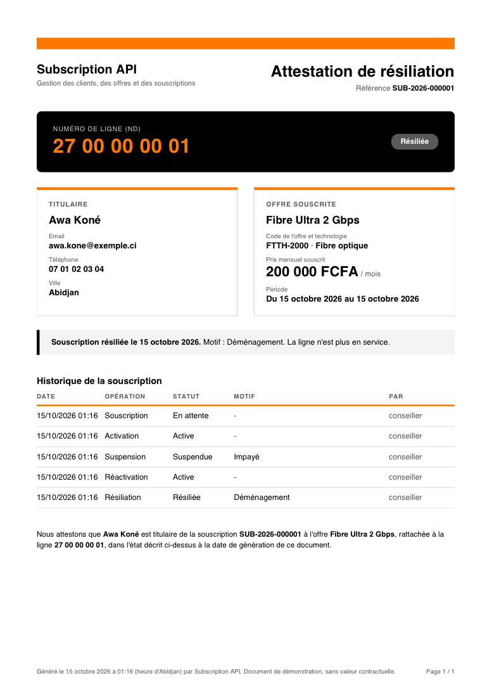

# Subscription API

[](https://github.com/Ultimatu/subscription-test-api/actions/workflows/ci.yml)

API REST de gestion des clients, du catalogue d'offres et des souscriptions d'un fournisseur d'accès (fibre, satellite, box 4G), réalisée avec Spring Boot 3 et PostgreSQL dans le cadre d'un test technique.

## Sommaire

1. [Description du projet](#1-description-du-projet)
2. [Prérequis](#2-prérequis)
3. [Démarrage rapide](#3-démarrage-rapide)
4. [Configuration de la base PostgreSQL](#4-configuration-de-la-base-postgresql)
5. [Lancement et tests](#5-lancement-et-tests)
6. [Architecture](#6-architecture)
7. [Endpoints](#7-endpoints)
8. [Transitions de statut d&#39;une souscription](#8-transitions-de-statut-dune-souscription)
9. [Règles métier](#9-règles-métier)
10. [Erreurs](#10-erreurs)
11. [Sécurité](#11-sécurité)
12. [Collection Postman et scénario de bout en bout](#12-collection-postman-et-scénario-de-bout-en-bout)
13. [Limites et améliorations](#13-limites-et-améliorations)
14. [Documentation complémentaire](#14-documentation-complémentaire)

## 1. Description du projet

L'API permet de :

- gérer les **clients** : création, recherche, modification, suppression, synthèse de leurs souscriptions ;
- gérer le **catalogue d'offres** : création, modification du libellé et du prix, retrait du catalogue ;
- gérer les **souscriptions** d'un client à une offre et leur cycle de vie : PENDING → ACTIVE → SUSPENDED → TERMINATED ;
- consulter des **statistiques** : souscriptions actives et revenu par ville, répartition par technologie, décompte par statut sur une période.

Les 22 règles métier de l'énoncé sont appliquées, dans l'ordre de vérification imposé. Les 11 offres du catalogue sont chargées au démarrage.

Au-delà de l'énoncé, sans en modifier le contrat d'API (mêmes URLs, mêmes corps de requête, mêmes codes HTTP) :

- **Extensions fonctionnelles**, décrites ensemble dans l'[ADR-0013](docs/adr/0013-extensions.md) : authentification JWT avec les rôles ADMIN et CONSEILLER, prix figé à la souscription, attestation PDF, exports CSV, notifications par email, retrait d'une technologie du catalogue, suppression définitive et durée de conservation, journal d'audit.
- **Choix techniques** : audit et historique des statuts avec leurs motifs ([ADR-0004](docs/adr/0004-audit-et-historique.md)), suppression logique ([ADR-0005](docs/adr/0005-suppression-logique.md)), technologies gérées comme des données, sans code ni déploiement ([ADR-0006](docs/adr/0006-technologies-donnees-de-reference.md)), erreurs au format Problem Details avec un `code` stable ([ADR-0007](docs/adr/0007-format-des-erreurs.md)), traçabilité par `X-Request-Id` ([ADR-0008](docs/adr/0008-tracabilite-des-requetes.md)), accès concurrents maîtrisés et prouvés par des tests ([ADR-0014](docs/adr/0014-souscriptions-numerotation-et-concurrence.md)), recherche insensible aux accents ([ADR-0017](docs/adr/0017-recherche-insensible-aux-accents.md)), schéma versionné par Flyway avec les règles doublées en base ([ADR-0002](docs/adr/0002-schema-versionne-flyway.md)), couverture et architecture vérifiées à chaque build ([ADR-0016](docs/adr/0016-couverture-de-code.md)), documentation OpenAPI (Swagger UI).

**Stack** : Java 17, Spring Boot 3.5 (Web, Data JPA, Validation, Security, OAuth2 Resource Server, Actuator), PostgreSQL, Flyway, springdoc-openapi, Thymeleaf et openhtmltopdf (PDF), Spring Mail, Lombok. Tests : JUnit 5, AssertJ, Mockito, Spring Security Test, GreenMail, ArchUnit, JaCoCo.

## 2. Prérequis

| Outil      | Version               | Remarque                                                                                                                                                                                                                                               |
| ---------- | --------------------- | ------------------------------------------------------------------------------------------------------------------------------------------------------------------------------------------------------------------------------------------------------ |
| JDK        | 17                    | Testé avec OpenJDK 17.0.18                                                                                                                                                                                                                            |
| Maven      | 3.6.3 ou plus récent | Facultatif : le dépôt contient le wrapper Maven (`./mvnw`), qui télécharge la bonne version                                                                                                                                                      |
| PostgreSQL | 13 ou plus récent    | Testé avec PostgreSQL 16. Le module *contrib* doit être installé (extension `unaccent`) : il l'est par défaut avec Homebrew, l'installeur Windows et l'image Docker officielle ; sous Debian ou Ubuntu, c'est le paquet `postgresql-contrib` |

Docker est facultatif : il peut fournir PostgreSQL à la place d'une installation locale, ainsi que Mailpit, qui affiche les emails envoyés par l'application (voir ci-dessous). Sans lui, l'application fonctionne normalement : les emails restent en attente dans la base.

## 3. Démarrage rapide

**Avec PostgreSQL installé**

```bash
# 1. Créer l'utilisateur et la base (une seule fois), avec un super-utilisateur PostgreSQL
#    (avec Homebrew, c'est l'utilisateur du système : retirer « -U postgres »)
psql -U postgres -c "CREATE USER subscription_user WITH PASSWORD 'subscription_pwd';"
psql -U postgres -c "CREATE DATABASE subscription_db OWNER subscription_user;"

# 2. Lancer l'application (Flyway crée le schéma et charge le catalogue au démarrage)
mvn spring-boot:run
```

**Ou avec Docker**, sans rien installer d'autre que le JDK

```bash
docker compose up -d      # PostgreSQL 16 (base et utilisateur de application.yml) et Mailpit
mvn spring-boot:run
```

Si un PostgreSQL local occupe déjà le port 5432 : `POSTGRES_PORT=5433 docker compose up -d`, puis `SPRING_DATASOURCE_URL=jdbc:postgresql://localhost:5433/subscription_db mvn spring-boot:run`. De même, le port SMTP de Mailpit se change par `MAILPIT_SMTP_PORT`, et celui qu'utilise l'application par `SPRING_MAIL_PORT`.

**Ou tout en conteneurs**, sans JDK ni Maven : `docker compose --profile app up --build` construit l'image de l'application (`Dockerfile`) et la lance avec PostgreSQL et Mailpit.

L'application écoute sur `http://localhost:8080` :

| Adresse                                   | Contenu                                                                 |
| ----------------------------------------- | ----------------------------------------------------------------------- |
| `http://localhost:8080/swagger-ui.html` | Documentation interactive (bouton « Authorize » pour saisir le jeton) |
| `http://localhost:8080/v3/api-docs`     | Spécification OpenAPI (JSON)                                           |
| `http://localhost:8080/actuator/health` | État de l'application                                                  |
| `http://localhost:8025`                 | Emails envoyés aux clients, reçus par Mailpit (avec Docker)           |

Toutes les routes `/api/**`, sauf la connexion, demandent un jeton, obtenu avec l'un des deux comptes de démonstration :

| Compte         | Mot de passe        | Droits                                                                |
| -------------- | ------------------- | --------------------------------------------------------------------- |
| `admin`      | `Admin@2026`      | Tous les droits                                                       |
| `conseiller` | `Conseiller@2026` | Clients et souscriptions, sans suppression, catalogue ni statistiques |

```bash
curl -X POST http://localhost:8080/api/auth/login \
     -H 'Content-Type: application/json' \
     -d '{ "username": "admin", "password": "Admin@2026" }'
```

La [collection Postman](#12-collection-postman-et-scénario-de-bout-en-bout) se connecte toute seule. Pour tester l'API sans jeton, la sécurité peut être désactivée : `APP_SECURITY_ENABLED=false mvn spring-boot:run`.

## 4. Configuration de la base PostgreSQL

La configuration se trouve dans `src/main/resources/application.yml` :

```yaml
spring:
  datasource:
    url: jdbc:postgresql://localhost:5432/subscription_db
    username: subscription_user
    password: subscription_pwd
  jpa:
    hibernate:
      ddl-auto: validate   # Hibernate vérifie le schéma, il ne le modifie jamais
    open-in-view: false
```

- **Schéma** : il est créé et mis à jour par **Flyway** au démarrage, à partir des migrations de `src/main/resources/db/migration` (V1 à V13). La migration V2 charge les 11 offres de l'énoncé, avec leurs libellés sans accents ; la migration V8 crée les deux comptes de démonstration. Le schéma, ses contraintes et ses index sont décrits dans [docs/base-de-donnees.md](docs/base-de-donnees.md).
- **Droits nécessaires** : l'utilisateur doit être propriétaire de la base, pour que Flyway puisse créer les tables, le schéma des tests et l'extension `unaccent` (extension de confiance, qui ne demande pas de droits de super-utilisateur).
- **Autre environnement** : les valeurs se remplacent par variables d'environnement, que Spring Boot associe automatiquement aux propriétés, sans modifier le fichier. Il n'y a pas de fichier `.env` : ce n'est pas la convention de Spring, et l'énoncé demande un simple `mvn spring-boot:run`. Le mot de passe de la base locale figure donc en clair, ce qui n'est acceptable que pour le développement :
  | Variable                                                                                       | Rôle                                                                                                                                                                                                                            |
  | ---------------------------------------------------------------------------------------------- | -------------------------------------------------------------------------------------------------------------------------------------------------------------------------------------------------------------------------------- |
  | `SPRING_DATASOURCE_URL`, `SPRING_DATASOURCE_USERNAME`, `SPRING_DATASOURCE_PASSWORD`      | Connexion à la base                                                                                                                                                                                                             |
  | `APP_SECURITY_JWT_SECRET`                                                                    | Clé de signature des jetons (256 bits en Base64) ; obligatoire hors développement                                                                                                                                              |
  | `APP_SECURITY_ENABLED`                                                                       | `false` pour désactiver l'authentification                                                                                                                                                                                    |
  | `SPRING_MAIL_HOST`, `SPRING_MAIL_PORT`, `SPRING_MAIL_USERNAME`, `SPRING_MAIL_PASSWORD` | Serveur de messagerie (Mailpit en local)                                                                                                                                                                                         |
  | `APP_NOTIFICATIONS_ENABLED`                                                                  | `false` pour ne plus envoyer les emails (ils sont tout de même enregistrés)                                                                                                                                                  |
  | `APP_DELETION_SOFT_DELETE`, `APP_DELETION_HARD_DELETE`                                     | Suppression logique des clients qui ont un historique ; purge par un administrateur                                                                                                                                              |
  | `APP_DELETION_RETENTION_ENABLED`, `APP_DELETION_RETENTION_PERIOD`                          | Délai de conservation avant la purge, et purge automatique : **à activer en production**, avec la durée fixée par l'ARTCI ([ADR-0013](docs/adr/0013-extensions.md#7-suppression-définitive-et-durée-de-conservation)) |
  | `APP_CORS_ALLOWED_ORIGINS` | Origines autorisées à appeler l'API depuis un navigateur (un back-office publié sur un autre domaine), séparées par des virgules ; aucune par défaut |
  | `SERVER_PORT`                                                                                | Port HTTP (8080 par défaut)                                                                                                                                                                                                     |
- **Tests** : ils utilisent la même base, dans un schéma séparé `test` que Flyway crée et migre automatiquement (`src/test/resources/config/application.yml`). Les données saisies via l'application ne perturbent pas les tests, et il n'y a pas de seconde base à créer.

## 5. Lancement et tests

PostgreSQL doit être démarré, pour l'application comme pour les tests.

| Commande                                  | Effet                                                                                                      |
| ----------------------------------------- | ---------------------------------------------------------------------------------------------------------- |
| `mvn spring-boot:run`                   | Lance l'application sur le port 8080                                                                       |
| `mvn test`                              | Exécute les 410 tests et produit le rapport de couverture `target/site/jacoco/index.html`               |
| `mvn test -DexcludedGroups=integration` | N'exécute que les tests unitaires, sans base de données ([ADR-0010](docs/adr/0010-strategie-de-tests.md)) |
| `mvn verify`                            | Idem, puis fait échouer le build sous 90 % de lignes ou 75 % de branches couvertes                        |

Sans Maven installé, remplacer `mvn` par `./mvnw` (`mvnw.cmd` sous Windows).

**Intégration continue** : à chaque push, GitHub Actions ([`.github/workflows/ci.yml`](.github/workflows/ci.yml)) lance `mvn verify` sur une base PostgreSQL 16, puis démarre l'application et rejoue la collection Postman avec Newman. Le rapport de couverture est conservé comme artefact de l'exécution.

**Couverture** (mesurée le 18/10/2026) :

| Périmètre                                              | Tests | Lignes | Branches |
| -------------------------------------------------------- | ----- | ------ | -------- |
| Tous les tests (`mvn test`)                            | 410   | 98,1 % | 85,9 %   |
| Tests unitaires seuls (`-DexcludedGroups=integration`) | 326   | 71,8 % | 62,5 %   |

Les 60 % de couverture demandés par l'énoncé sont donc atteints par les seuls tests unitaires. Chaque couche est testée au niveau qui lui correspond, du domaine en Java pur jusqu'à l'application démarrée ([ADR-0010](docs/adr/0010-strategie-de-tests.md)). Parmi les tests notables : les 16 combinaisons statut × opération confrontées au tableau de l'énoncé, l'ordre de vérification de la règle 15, la matrice des droits avec de vrais jetons, le contenu réel du PDF et des emails, et des requêtes HTTP réellement concurrentes, dont chaque cas échoue si l'on retire la protection qu'il vérifie ([ADR-0014](docs/adr/0014-souscriptions-numerotation-et-concurrence.md)).

## 6. Architecture

### Choix : architecture hexagonale

L'API ne gère que trois entités, mais sa complexité est surtout métier : 22 règles, un cycle de vie avec des transitions interdites, un ordre de vérification imposé. L'**architecture hexagonale** (ports et adaptateurs) isole ces règles de la technique : elles se testent en Java pur, en quelques millisecondes, sans base de données ni HTTP.

Elle a un coût : plus de classes qu'une architecture en couches classique, et une duplication assumée entre le modèle du domaine et l'entité JPA. Sur un simple CRUD, elle serait surdimensionnée. Elle est appliquée ici de façon pragmatique, sans tout découper : un port d'entrée par agrégat plutôt qu'un par cas d'usage (un agrégat n'en a plusieurs que lorsqu'une partie de ses cas d'usage évolue pour d'autres raisons, comme la suppression et la conservation des clients), et la pagination de Spring Data acceptée dans la couche application. Le détail et les alternatives sont dans l'[ADR-0001](docs/adr/0001-architecture-hexagonale.md).

Les dépendances pointent toujours vers le centre : `infrastructure` → `application` → `domain`. Le test `ArchitectureTest` (ArchUnit) le vérifie à chaque build.

Les constructeurs d'injection sont écrits à la main, sans `@RequiredArgsConstructor` : le compilateur Eclipse 4.42, embarqué dans les extensions Java de VS Code et d'Eclipse, compile mal en Java 17 les constructeurs générés par Lombok, et produit des classes qui échouent à l'exécution ([lombok#4086](https://github.com/projectlombok/lombok/issues/4086)). Lombok ne sert qu'à `@Getter`, `@Setter` et `@Slf4j`.

### Arborescence

```
subscription-api/
├── docs/                           décisions d'architecture (ADR), interprétations, schéma de la base
├── postman/                        collection Postman
├── src/main/java/ci/orange/subscription/
│   ├── domain/                     le métier, en Java pur
│   │   ├── client/                 Client, ClientStatus
│   │   ├── offer/                  Offer
│   │   ├── technology/             Technology
│   │   ├── subscription/           Subscription, SubscriptionTransition, SubscriptionEligibility…
│   │   ├── exception/              exceptions métier et leurs codes (DomainErrorCode)
│   │   └── common/                 validations et informations d'audit partagées
│   ├── application/                les cas d'usage
│   │   ├── port/in/                ce que l'application sait faire (ClientUseCases…), commandes, vues
│   │   ├── port/out/               ce dont elle a besoin (ClientRepository, SubscriptionNumberSequences…)
│   │   └── service/                implémentation des cas d'usage, transactions, ordre des règles
│   └── infrastructure/             les adaptateurs
│       ├── web/                    controllers REST, DTO, gestion des erreurs, traçabilité des requêtes
│       ├── persistence/            entités JPA, repositories Spring Data, implémentation des ports de sortie
│       ├── security/               JWT, comptes utilisateurs, matrice des droits
│       ├── document/               attestation PDF (gabarit Thymeleaf converti par openhtmltopdf)
│       ├── notification/           envoi des emails (Spring Mail)
│       ├── scheduling/             tâches planifiées : envoi des notifications, purge des données expirées
│       └── config/                 horloge, préfixe /api, OpenAPI
├── src/main/resources/
│   ├── application.yml
│   ├── db/migration/               migrations Flyway V1 à V13
│   └── templates/                  gabarits de l'attestation (documents/) et des emails (notifications/)
└── src/test/java/                  tests, dans la même arborescence
```

### Rôle de chaque couche

| Couche                          | Rôle                                                                                                                                                                                                                                                         |
| ------------------------------- | ------------------------------------------------------------------------------------------------------------------------------------------------------------------------------------------------------------------------------------------------------------- |
| `domain`                      | Modèles riches qui protègent leurs invariants : `Client.create` force le statut ACTIVE, `subscription.suspend(reason)` refuse une transition interdite et enregistre le changement de statut. Aucun import Spring, JPA ou Jackson : ne dépend de rien. |
| `application`                 | Cas d'usage : charge les objets métier par les ports de sortie, applique les règles dans l'ordre imposé, enregistre le résultat. Porte les transactions (`@Transactional`). Ne dépend que du domaine.                                                  |
| `infrastructure.web`          | Traduit HTTP en appels aux ports d'entrée : validation des corps de requête (Bean Validation), conversion DTO ↔ modèle, conversion des exceptions en réponses Problem Details, identifiant de requête.                                                  |
| `infrastructure.persistence`  | Implémente les ports de sortie avec JPA. Les entités JPA (`ClientEntity`…) sont distinctes des modèles du domaine, reliées par un mapping manuel.                                                                                                      |
| `infrastructure.security`     | Émission et vérification des jetons, comptes utilisateurs, droits par rôle.                                                                                                                                                                                |
| `infrastructure.document`     | Mise en page de l'attestation : gabarit HTML et CSS rendu en PDF.                                                                                                                                                                                             |
| `infrastructure.notification` | Envoi des emails (SMTP).                                                                                                                                                                                                                                      |
| `infrastructure.scheduling`   | Tâches planifiées : envoi des notifications de l'outbox, purge des clients dont le délai de conservation est écoulé.                                                                                                                                     |
| `infrastructure.config`       | Assemblage : horloge (fuseau Africa/Abidjan), préfixe `/api`, description OpenAPI.                                                                                                                                                                         |

Les adaptateurs de `infrastructure` dépendent de `application` et de `domain`, jamais l'inverse : le métier ignore qu'il est exposé en HTTP et stocké dans PostgreSQL.

### Parcours d'une requête

Exemple : `POST /api/subscriptions/suspend` avec `{ "subscriptionId": 1, "reason": "Impayé" }`.

1. `RequestTracingFilter` reprend l'en-tête `X-Request-Id` ou en génère un, et le place dans chaque ligne de log.
2. Spring Security vérifie le jeton et le rôle.
3. `SubscriptionController` (web) valide le corps (`reason` non vide, pas de `nd`), puis appelle `SubscriptionUseCases.suspend`.
4. `SubscriptionService` (application) verrouille le client de la souscription, charge la souscription par le port `SubscriptionRepository`, puis appelle `subscription.suspend("Impayé")`.
5. `Subscription` (domaine) vérifie que la transition ACTIVE → SUSPENDED est permise et enregistre le changement, avec son motif.
6. `SubscriptionPersistenceAdapter` (persistance) enregistre la souscription et ajoute une ligne à l'historique des statuts.
7. Le controller renvoie le détail de la souscription. En cas d'erreur, `GlobalExceptionHandler` produit la réponse Problem Details (ici, 409 si la souscription n'est pas ACTIVE).

## 7. Endpoints

Toutes les routes métier sont préfixées par `/api`, déclaré une seule fois (`WebConfig`) pour les seuls controllers métier : Swagger UI et Actuator gardent leurs chemins habituels. Les URLs sont exactement celles de l'énoncé, sans numéro de version (voir [Limites et améliorations](#13-limites-et-améliorations)). **Rôles** : *Conseiller* signifie accessible aux rôles CONSEILLER et ADMIN ; *Admin*, au seul rôle ADMIN. Les listes sont paginées (`page` à partir de 0, `size` 20 par défaut et 100 au maximum, `sort=champ,asc|desc`). Les paramètres et corps de requête sont ceux de l'énoncé ; Swagger UI les détaille, avec les réponses et les erreurs possibles de chaque endpoint.

### Clients

| Méthode | URL                                     | Description                                                | Succès | Rôle       |
| ------- | --------------------------------------- | ---------------------------------------------------------- | ------ | ---------- |
| POST    | `/api/clients`                          | Créer un client                                            | 201    | Conseiller |
| GET     | `/api/clients`                          | Lister les clients                                         | 200    | Conseiller |
| GET     | `/api/clients/{id}`                     | Détail d'un client                                         | 200    | Conseiller |
| PUT     | `/api/clients/{id}`                     | Modifier un client                                         | 200    | Conseiller |
| DELETE  | `/api/clients/{id}`                     | Supprimer un client                                        | 204    | Admin      |
| GET     | `/api/clients/{id}/summary`             | Nombre de souscriptions par statut et revenu mensuel total | 200    | Conseiller |
| GET     | `/api/clients/{clientId}/subscriptions` | Souscriptions d'un client                                  | 200    | Conseiller |

### Offres

| Méthode | URL                           | Description                    | Succès | Rôle       |
| ------- | ----------------------------- | ------------------------------ | ------ | ---------- |
| POST    | `/api/offers`                 | Créer une offre                | 201    | Admin      |
| GET     | `/api/offers`                 | Lister les offres              | 200    | Conseiller |
| GET     | `/api/offers/{id}`            | Détail d'une offre             | 200    | Conseiller |
| PUT     | `/api/offers/{id}`            | Modifier une offre             | 200    | Admin      |
| PATCH   | `/api/offers/{id}/deactivate` | Retirer une offre du catalogue | 200    | Admin      |

### Souscriptions

| Méthode | URL                             | Description                                                 | Succès | Rôle       |
| ------- | ------------------------------- | ----------------------------------------------------------- | ------ | ---------- |
| POST    | `/api/subscriptions`            | Souscrire à une offre                                       | 201    | Conseiller |
| GET     | `/api/subscriptions`            | Recherche globale                                           | 200    | Conseiller |
| GET     | `/api/subscriptions/{id}`       | Détail, avec le client, l'offre et l'historique des statuts | 200    | Conseiller |
| GET     | `/api/subscriptions/by-nd/{nd}` | Retrouver une souscription par son ND                       | 200    | Conseiller |
| POST    | `/api/subscriptions/activate`   | PENDING → ACTIVE                                            | 200    | Conseiller |
| POST    | `/api/subscriptions/suspend`    | ACTIVE → SUSPENDED                                          | 200    | Conseiller |
| POST    | `/api/subscriptions/reactivate` | SUSPENDED → ACTIVE                                          | 200    | Conseiller |
| POST    | `/api/subscriptions/terminate`  | → TERMINATED                                                | 200    | Conseiller |
| DELETE  | `/api/subscriptions/{id}`       | Supprimer une souscription PENDING                          | 204    | Admin      |

### Statistiques

| Méthode | URL                                      | Description                                           | Succès | Rôle  |
| ------- | ---------------------------------------- | ----------------------------------------------------- | ------ | ----- |
| GET     | `/api/stats/subscriptions-by-city`       | Souscriptions actives et revenu mensuel par ville     | 200    | Admin |
| GET     | `/api/stats/subscriptions-by-technology` | Répartition des souscriptions actives par technologie | 200    | Admin |
| GET     | `/api/stats/subscriptions-by-status`     | Nombre de souscriptions par statut sur une période    | 200    | Admin |

Le paramètre facultatif `basedOn`, ajouté à `subscriptions-by-status`, précise quelle date doit tomber dans la période : `CREATION_DATE` (par défaut), `START_DATE` ou `STATUS_CHANGE` (changements de statut survenus pendant la période, d'après l'historique).

### Hors énoncé

| Méthode | URL                                     | Description                                                                                           | Succès | Rôle       |
| ------- | --------------------------------------- | ----------------------------------------------------------------------------------------------------- | ------ | ---------- |
| POST    | `/api/auth/login`                       | Obtenir un jeton (`username`, `password`)                                                             | 200    | Public     |
| GET     | `/api/technologies`                     | Lister les technologies (`active` pour filtrer)                                                       | 200    | Conseiller |
| GET     | `/api/technologies/{code}`              | Détail d'une technologie                                                                              | 200    | Conseiller |
| GET     | `/api/subscriptions/{id}/attestation`   | Télécharger l'attestation de souscription ou de résiliation (PDF)                                     | 200    | Conseiller |
| GET     | `/api/clients/export`                   | Exporter les clients en CSV (filtres de la liste)                                                     | 200    | Admin      |
| GET     | `/api/subscriptions/export`             | Exporter les souscriptions en CSV (filtres de la recherche globale)                                   | 200    | Admin      |
| GET     | `/api/subscriptions/{id}/notifications` | Emails envoyés au client, avec leur état d'envoi                                                      | 200    | Conseiller |
| POST    | `/api/technologies`                     | Ajouter une technologie (`code`, `label`)                                                             | 201    | Admin      |
| PATCH   | `/api/technologies/{code}/deactivate`   | Retirer une technologie du catalogue                                                                  | 200    | Admin      |
| PATCH   | `/api/technologies/{code}/activate`     | Remettre une technologie au catalogue                                                                 | 200    | Admin      |
| GET     | `/api/audit-events`                     | Journal d'audit, filtrable par ressource, auteur, action et période                                   | 200    | Admin      |
| GET     | `/api/clients/deleted`                  | Clients supprimés en attente de purge, avec la date à partir de laquelle ils pourront l'être          | 200    | Admin      |
| DELETE  | `/api/clients/{id}/purge`               | Suppression définitive d'un client et de tout son historique, dans la limite du délai de conservation | 204    | Admin      |

## 8. Transitions de statut d'une souscription



Chaque opération est un `POST` de l'énoncé (`/api/subscriptions/activate`, `/suspend`, `/reactivate`, `/terminate`). La suspension et la résiliation exigent un motif, conservé dans l'historique ; la résiliation fixe la date de fin au jour même. Toute autre transition est refusée par une **409**, qui indique le statut courant et le statut requis :

```json
{
  "type": "about:blank",
  "title": "Transition de statut interdite",
  "status": 409,
  "detail": "Opération ACTIVATE impossible : la souscription est au statut SUSPENDED, statut requis : PENDING",
  "instance": "/api/subscriptions/activate",
  "code": "INVALID_STATUS_TRANSITION",
  "timestamp": "2026-10-15T00:17:51.780604Z",
  "requestId": "e7ae7c6d-1a4a-4df8-a781-0dbed69616af",
  "currentStatus": "SUSPENDED",
  "requiredStatuses": ["PENDING"]
}
```

Dans le code, les transitions sont décrites par l'enum `SubscriptionTransition`, qui reprend ce tableau : une constante par opération, avec ses statuts de départ et son statut d'arrivée.

## 9. Règles métier

Chaque règle est appliquée dans le domaine ou dans les services ; les règles d'unicité et de format sont en plus garanties par des contraintes en base.

| Règle | Résumé                                                                                                                                           | En cas de violation                                                                                          |
| ------ | -------------------------------------------------------------------------------------------------------------------------------------------------- | ------------------------------------------------------------------------------------------------------------ |
| 1      | Email unique, non modifiable                                                                                                                       | 409 `CLIENT_EMAIL_ALREADY_USED` ; 400 si `email` est envoyé dans le `PUT`                             |
| 2      | Téléphone : dix chiffres commençant par 01, 05 ou 07                                                                                            | 400 `VALIDATION_ERROR`                                                                                     |
| 3      | Client créé ACTIVE, `status` ignoré à la création                                                                                           | —                                                                                                           |
| 4      | Statut du client modifiable par le `PUT`, dans les deux sens                                                                                     | —                                                                                                           |
| 5      | Pas de nouvelle souscription pour un client INACTIVE                                                                                               | 409 `CLIENT_INACTIVE`                                                                                      |
| 6      | Suppression refusée si une souscription est PENDING, ACTIVE ou SUSPENDED                                                                          | 409 `CLIENT_HAS_ONGOING_SUBSCRIPTIONS`                                                                     |
| 7      | Code d'offre unique et en majuscules                                                                                                               | 409 `OFFER_CODE_ALREADY_USED` ; 400 `VALIDATION_ERROR`                                                   |
| 8      | Prix mensuel strictement positif, deux décimales au plus                                                                                          | 400 `VALIDATION_ERROR`                                                                                     |
| 9      | Offre créée active ; désactivation uniquement par `PATCH`                                                                                     | 400 si `active` est envoyé dans le `PUT`                                                                |
| 10     | Code et technologie non modifiables                                                                                                                | 400 si `code` ou `technology` sont envoyés dans le `PUT`                                              |
| 11     | Une offre désactivée n'accepte plus de souscription                                                                                              | 409 `OFFER_INACTIVE`                                                                                       |
| 12     | Souscription pour un client ACTIVE et une offre active                                                                                             | 409 `CLIENT_INACTIVE`, `OFFER_INACTIVE`                                                                  |
| 13     | Une souscription SUSPENDED bloque toute nouvelle souscription                                                                                      | 409 `CLIENT_HAS_SUSPENDED_SUBSCRIPTION`                                                                    |
| 14     | Une seule souscription PENDING ou ACTIVE par technologie                                                                                           | 409 `TECHNOLOGY_ALREADY_SUBSCRIBED`                                                                        |
| 15     | Ordre : client actif → offre active → blocage global → unicité par technologie                                                                 | La première règle enfreinte, dans cet ordre                                                                |
| 16     | Référence `SUB-{ANNÉE}-{6 chiffres}` générée par le serveur                                                                                | 400 si `reference` est envoyée                                                                            |
| 17     | ND `27XXXXXXXX` unique, attribué par le serveur                                                                                                 | —                                                                                                           |
| 18     | ND jamais modifiable                                                                                                                               | 400 si `nd` est envoyé dans un corps                                                                      |
| 19     | Date de début aujourd'hui ou plus tard                                                                                                            | 400 `START_DATE_IN_PAST`                                                                                   |
| 20     | Motif obligatoire pour la suspension et la résiliation, conservé                                                                                 | 400 `VALIDATION_ERROR`                                                                                     |
| 21     | Résiliation définitive, date de fin à la date du jour                                                                                           | 409 `INVALID_STATUS_TRANSITION` sur toute opération ultérieure                                           |
| 22     | Seule une souscription PENDING peut être supprimée                                                                                               | 409 `SUBSCRIPTION_NOT_DELETABLE`                                                                           |
| —     | Hors énoncé : une technologie retirée du catalogue n'accepte plus de nouvelle offre ni de souscription ; vérifiée juste après l'offre active | 409 `TECHNOLOGY_INACTIVE` ([ADR-0013](docs/adr/0013-extensions.md#6-retrait-dune-technologie-du-catalogue)) |
| —     | Hors énoncé : code et libellé d'une technologie uniques, le libellé sans tenir compte de la casse ni des accents                          | 409 `TECHNOLOGY_ALREADY_EXISTS`, `TECHNOLOGY_LABEL_ALREADY_USED` ([ADR-0006](docs/adr/0006-technologies-donnees-de-reference.md)) |

Les points sur lesquels l'énoncé laisse une marge d'interprétation (casse de l'email, fuseau de « la date du jour », décimales des montants, sort des souscriptions d'un client supprimé, revenu pris en compte…) sont recensés, avec le choix retenu, dans [docs/interpretations.md](docs/interpretations.md).

## 10. Erreurs

Toutes les erreurs suivent le format **Problem Details** (RFC 9457), complété par les champs suivants ([ADR-0007](docs/adr/0007-format-des-erreurs.md) ; exemple complet au [§8](#8-transitions-de-statut-dune-souscription)) :

- `code` : un identifiant stable en majuscules (ex. `CLIENT_EMAIL_ALREADY_USED`), sur lequel un client de l'API peut s'appuyer sans analyser le message ;
- `timestamp` et `requestId` : l'identifiant de la requête, également renvoyé dans l'en-tête `X-Request-Id` et présent dans chaque ligne de log ;
- `errors` : la liste des champs invalides, pour les erreurs de validation (`field`, `message`).

| Statut | Signification                                                                      |
| ------ | ---------------------------------------------------------------------------------- |
| 400    | Données invalides (format, champ obligatoire, champ non modifiable, date passée) |
| 401    | Jeton absent, invalide ou expiré ; identifiants incorrects                        |
| 403    | Rôle insuffisant                                                                  |
| 404    | Ressource introuvable                                                              |
| 409    | Règle métier enfreinte, transition interdite, modification concurrente           |

Quand plusieurs problèmes se cumulent, les données invalides (400) sont signalées avant les conflits (409). Une erreur interne (500) ne révèle jamais de détail technique.

## 11. Sécurité

L'API est un outil de back-office, utilisé par des conseillers et des administrateurs, pas par les clients finaux. `POST /api/auth/login` délivre un jeton JWT valable une heure, à transmettre dans l'en-tête `Authorization: Bearer <jeton>` ; les droits de chaque rôle figurent dans la colonne « Rôle » des [endpoints](#7-endpoints). `APP_SECURITY_ENABLED=false` ouvre toute l'API sans jeton, pour tester le contrat de l'énoncé tel quel. Les comptes de démonstration et la clé de signature de `application.yml` ne servent qu'au développement : en production, la clé vient de `APP_SECURITY_JWT_SECRET`.

Le détail (matrice des droits, mots de passe, exports, purge, journal d'audit) est dans l'[ADR-0013](docs/adr/0013-extensions.md#1-authentification-jwt-et-rôles).

## 12. Collection Postman et scénario de bout en bout

### Utilisation

1. Lancer l'application (`mvn spring-boot:run`).
2. Dans Postman, importer `postman/subscription-api.postman_collection.json`.
3. Cliquer sur *Run collection* : les 101 requêtes s'exécutent dans l'ordre et vérifient 198 assertions (codes HTTP, statuts, codes d'erreur).

La collection **se connecte toute seule** : avant chaque requête, elle obtient ou renouvelle les jetons de l'administrateur et du conseiller. Chaque requête utilise le jeton du rôle indiqué dans son nom (administrateur par défaut). Les données sont générées à chaque exécution : la collection peut être rejouée autant de fois que nécessaire. La variable de collection `baseUrl` vaut `http://localhost:8080`.

En ligne de commande, avec Node.js :

```bash
npx newman run postman/subscription-api.postman_collection.json
```

| Dossier                                | Contenu                                                                                                                                                                                                                                                    |
| -------------------------------------- | ---------------------------------------------------------------------------------------------------------------------------------------------------------------------------------------------------------------------------------------------------------- |
| 0 · Authentification                  | Connexion en administrateur et en conseiller                                                                                                                                                                                                               |
| 1 · Scénario de bout en bout         | Les 7 étapes de l'énoncé, puis la vérification de l'historique, l'attestation de résiliation et les notifications envoyées au client                                                                                                                 |
| 2 · Règles métier                   | Les règles démontrées par leurs cas d'erreur, et les contrôles de droits (401, 403, export refusé au conseiller)                                                                                                                                      |
| 3 · Clients                           | Tous les endpoints des clients, export CSV compris                                                                                                                                                                                                         |
| 4 · Offres                            | Tous les endpoints des offres                                                                                                                                                                                                                              |
| 5 · Technologies                      | Catalogue des technologies                                                                                                                                                                                                                                 |
| 6 · Souscriptions                     | Détail, recherche par ND, recherche globale, export CSV, liste par client, attestation, suppression                                                                                                                                                       |
| 7 · Statistiques                      | Les trois indicateurs                                                                                                                                                                                                                                      |
| 8 · Parcours complet de l'application | Toutes les fonctionnalités enchaînées, y compris les extensions : technologie retirée puis remise au catalogue, prix figé, cycle de vie, attestations, notifications, statistiques, exports, journal d'audit, puis suppression, conservation et purge |

Le dossier 1 reproduit à l'identique le scénario demandé par l'énoncé ; le dossier 8 est un parcours complémentaire, qui montre l'ensemble de l'application sans modifier ce scénario.

La spécification OpenAPI (`http://localhost:8080/v3/api-docs`) peut aussi être importée dans Postman, qui génère alors une requête par endpoint, sans le scénario ni les vérifications.

### Scénario de bout en bout

Création client → offre → souscription → activation → suspension → réactivation → résiliation, rejoué sur l'application. Chaque requête porte `Content-Type: application/json` et l'en-tête `Authorization: Bearer <jeton>` du rôle indiqué, obtenu par `POST /api/auth/login` (la collection s'en charge). Seuls les champs utiles des réponses sont reproduits ; leur détail complet figure dans Swagger UI.

```http
# 1. Création du client (conseiller)
POST /api/clients
{ "firstName": "Awa", "lastName": "Koné", "email": "awa.kone@exemple.ci", "phoneNumberClient": "0701020304", "city": "Abidjan" }
# → 201 Created  { "id": 14, "status": "ACTIVE", "createdBy": "conseiller", … }

# 2. Création de l'offre (administrateur)
POST /api/offers
{ "code": "FTTH-2000", "label": "Fibre Ultra 2 Gbps", "technology": "FTTH", "monthlyPrice": 200000 }
# → 201 Created  { "id": 18, "monthlyPrice": 200000.00, "active": true, … }

# 3. Souscription (conseiller) : la référence et le ND sont attribués par le serveur
POST /api/subscriptions
{ "clientId": 14, "offerId": 18, "startDate": "2026-10-15" }
# → 201 Created  { "id": 14, "reference": "SUB-2026-000001", "nd": "2700000001", "status": "PENDING", "monthlyPrice": 200000.00, … }

# 4 à 6. Activation, suspension, réactivation (conseiller) : l'identifiant passe dans le corps, comme l'impose l'énoncé
POST /api/subscriptions/activate
{ "subscriptionId": 14 }
# → 200 OK  { "status": "ACTIVE", … }

POST /api/subscriptions/suspend
{ "subscriptionId": 14, "reason": "Impayé" }
# → 200 OK  { "status": "SUSPENDED", … }

POST /api/subscriptions/reactivate
{ "subscriptionId": 14 }
# → 200 OK  { "status": "ACTIVE", … }

# 7. Résiliation (conseiller)
POST /api/subscriptions/terminate
{ "subscriptionId": 14, "reason": "Déménagement" }
```

La résiliation renvoie la souscription avec sa date de fin et tout son historique, motifs et auteurs compris :

```json
200 OK
{
  "id": 14,
  "reference": "SUB-2026-000001",
  "nd": "2700000001",
  "status": "TERMINATED",
  "startDate": "2026-10-15",
  "endDate": "2026-10-15",
  …
  "history": [
    { "from": null,        "to": "PENDING",    "reason": null,           "changedBy": "conseiller", … },
    { "from": "PENDING",   "to": "ACTIVE",     "reason": null,           "changedBy": "conseiller", … },
    { "from": "ACTIVE",    "to": "SUSPENDED",  "reason": "Impayé",       "changedBy": "conseiller", … },
    { "from": "SUSPENDED", "to": "ACTIVE",     "reason": null,           "changedBy": "conseiller", … },
    { "from": "ACTIVE",    "to": "TERMINATED", "reason": "Déménagement", "changedBy": "conseiller", … }
  ]
}
```

**8. Attestation de résiliation** (conseiller) : `GET /api/subscriptions/14/attestation` renvoie le PDF, nommé `attestation-SUB-2026-000001.pdf`.

<p align="center"></p>

**9. Notifications** : chaque changement de statut a envoyé un email au client ; `GET /api/subscriptions/14/notifications` les liste, avec leur état d'envoi. Avec Docker, ils s'affichent dans Mailpit (`http://localhost:8025`) ; l'attestation est jointe à l'activation et à la résiliation.

<p align="center"></p>

Le dossier « 2 · Règles métier » de la collection démontre ensuite les cas d'erreur : doublon d'email, souscription bloquée par une suspension (règles 13 et 15), unicité par technologie (règle 14), transition interdite, suppression refusée, droits insuffisants.

## 13. Limites et améliorations

### Extensions réalisées

Ces extensions sont celles que j'aurais inscrites dans cette section. Le délai laissé pour le test étant largement suffisant, elles ont été réalisées, au-delà de l'énoncé et sans modifier son contrat d'API : authentification et rôles, prix figé à la souscription, attestation PDF, exports CSV, notifications par email, retrait d'une technologie du catalogue, suppression définitive et durée de conservation, journal d'audit. Elles sont décrites ensemble dans l'[ADR-0013](docs/adr/0013-extensions.md).

### Pistes restantes

Ce que j'aurais fait avec plus de temps, ou dans un contexte de production :

**API**

- **Versionner l'API** (`/api/v1`) : l'énoncé fixe des URLs sans version, conservées telles quelles. Le préfixe étant déclaré à un seul endroit, l'ajout d'une version ne toucherait qu'une ligne.
- **Clés d'idempotence** sur les `POST` (en-tête `Idempotency-Key`), pour qu'un appel rejoué après une coupure réseau reçoive la réponse du premier, au lieu d'un 409. Les règles d'unicité empêchent déjà tout doublon (un `POST /api/subscriptions` rejoué est refusé par la règle 14, un client rejoué par l'unicité de l'email), mais l'appelant ne sait pas si son premier appel a réussi.
- **Détecter les modifications fondées sur une lecture ancienne** : la version des ressources n'est pas exposée. Si deux conseillers consultent le même client puis l'enregistrent l'un après l'autre (`GET`, puis `PUT`), le second écrase la modification du premier sans le savoir ; le verrou optimiste ne protège que des transactions simultanées. Un en-tête `ETag` sur les lectures et un `If-Match` sur les `PUT` (412 si la ressource a changé entre-temps) régleraient le problème ; facultatifs, ils ne modifieraient pas le contrat de l'énoncé ([ADR-0014](docs/adr/0014-souscriptions-numerotation-et-concurrence.md)).

**Métier**

- **Publier les changements de statut vers les autres systèmes** (facturation, provisionnement de la ligne) par un broker de messages, en réutilisant l'outbox des notifications.
- **Figer le contenu des notifications** à leur enregistrement, pour prévenir aussi un client dont la souscription est supprimée avant l'envoi, et **purger** périodiquement les notifications envoyées.
- **Anonymiser plutôt que purger** les clients dont le délai de conservation est écoulé, pour garder des statistiques sur des souscriptions réellement anonymes (loi n° 2013-450, art. 16).
- **Expiration des souscriptions oubliées** : aucune vérification automatique ne porte aujourd'hui sur les souscriptions. Une souscription PENDING jamais activée occupe sa technologie (règle 14), et une souscription SUSPENDED jamais régularisée bloque toute nouvelle souscription du client (règle 13), sans limite de temps. Une tâche quotidienne, sur le modèle de la purge, résilierait automatiquement une souscription PENDING non activée 30 jours après sa date de début et une souscription suspendue depuis plus de 90 jours (délais réglables). Elle passerait par le domaine comme une résiliation manuelle : transitions autorisées par l'énoncé, historique avec motif, email au client avec son attestation, journal d'audit signé « system ».
- **Contrats à durée déterminée** (engagement de 12 mois, renouvellement tacite) : il faudrait une durée sur l'offre et une date de fin prévue sur la souscription. L'activation, elle, resterait manuelle : pour une ligne fibre ou satellite, elle suit une installation technique, pas une date du calendrier.

**Sécurité**

- **Fournisseur d'identité** (Keycloak, Azure AD…) : l'API ne ferait plus que vérifier les jetons, et la table des comptes disparaîtrait.
- **Jeton de rafraîchissement** et **révocation** des jetons ; aujourd'hui, il faut se reconnecter au bout d'une heure, et un jeton reste valable jusqu'à son expiration.
- **Limitation du débit** sur la connexion, contre les tentatives répétées de mots de passe.

**Données et performance**

- **Index trigrammes** (`pg_trgm`) pour les recherches partielles, qui parcourent aujourd'hui toute la table, un index d'expression sur la ville sans accents (par une fonction `IMMUTABLE` intermédiaire, `unaccent` étant `STABLE`) et un index sur la date des changements de statut pour les statistiques ; le schéma actuel est dimensionné pour quelques dizaines de milliers de clients.
- **Cache** du catalogue d'offres et de technologies, qui change rarement.
- **Documents en masse** (relevés mensuels de tous les clients, par exemple) : une file de traitements (JobRunr sur PostgreSQL, ou un broker de messages). Inutile pour une attestation unitaire, générée en quelques dizaines de millisecondes ([ADR-0013](docs/adr/0013-extensions.md#3-attestation-pdf)).

**Tests et exploitation**

- **Testcontainers** : chaque exécution des tests aurait sa propre base PostgreSQL jetable. Écarté parce qu'il exige Docker, que l'énoncé ne prévoit pas ([ADR-0010](docs/adr/0010-strategie-de-tests.md)).
- **Exiger un seuil de couverture propre aux tests unitaires** : ils sont isolés par une étiquette et mesurés à part ([ADR-0010](docs/adr/0010-strategie-de-tests.md)), mais le build ne vérifie que la couverture de l'ensemble des tests ([ADR-0016](docs/adr/0016-couverture-de-code.md)).
- **Tests de contrat** de l'API générés depuis la spécification OpenAPI.
- **Observabilité** : métriques Prometheus (Micrometer), logs au format JSON, traces distribuées avec OpenTelemetry, en plus de l'identifiant de requête actuel.

## 14. Documentation complémentaire

| Document                                          | Contenu                                                                                                                                          |
| ------------------------------------------------- | ------------------------------------------------------------------------------------------------------------------------------------------------ |
| [docs/adr/](docs/adr/README.md)                    | Les décisions d'architecture (contexte, décision, alternatives écartées et conséquences), dont une fiche qui regroupe toutes les extensions |
| [docs/interpretations.md](docs/interpretations.md) | Les points ambigus de l'énoncé et le choix retenu pour chacun                                                                                  |
| [docs/base-de-donnees.md](docs/base-de-donnees.md) | Tables et relations, contraintes reliées aux règles métier, index et requêtes qu'ils servent                                                 |
| Swagger UI (`/swagger-ui.html`)                 | Chaque endpoint, ses paramètres, ses réponses et ses erreurs                                                                                   |

Souleymane Tonde
