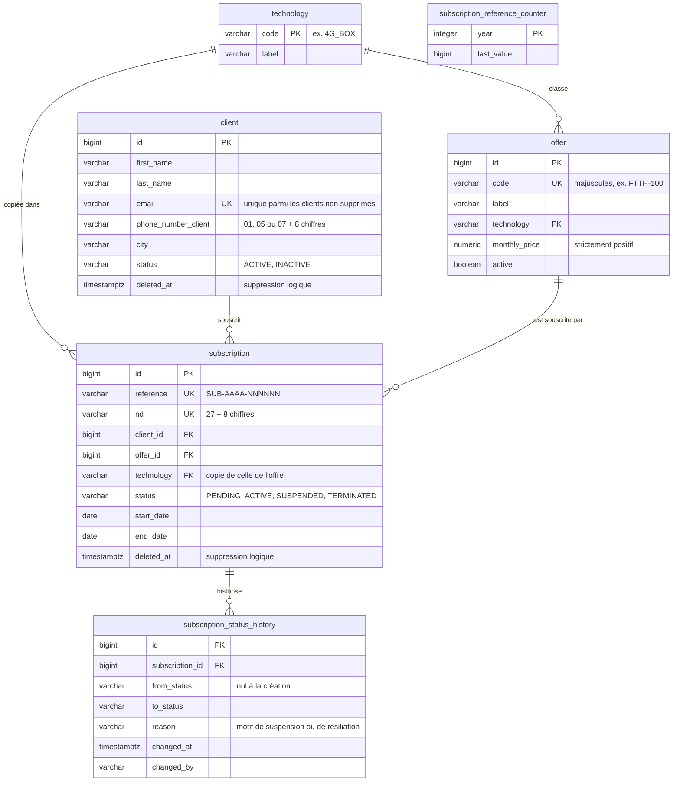

# Base de données

Schéma PostgreSQL de l'application, tel qu'il résulte des migrations Flyway V1 à V7 (`src/main/resources/db/migration`). Le schéma n'est jamais modifié par Hibernate, qui se contente de vérifier au démarrage que les entités lui correspondent ([ADR-0002](adr/0002-schema-versionne-flyway.md)).

## Tables et relations

Colonnes communes, omises du diagramme :

- **Audit** ([ADR-0004](adr/0004-audit-et-historique.md)) : `created_at`, `created_by`, `updated_at`, `updated_by` sur `technology`, `offer`, `client` et `subscription` ;
- **Verrou optimiste** : `version` sur ces mêmes tables ;
- **Suppression logique** ([ADR-0005](adr/0005-suppression-logique.md)) : `deleted_by` à côté de `deleted_at`, sur `client` et `subscription`.

Autres objets :

- la **séquence `subscription_nd_seq`** (de 1 à 99 999 999), dont dérive le ND ([ADR-0014](adr/0014-souscriptions-numerotation-et-concurrence.md)) ;
- la table **`subscription_reference_counter`**, un compteur par année pour la référence, incrémenté atomiquement ;
- l'**extension `unaccent`**, pour la recherche insensible aux accents ([ADR-0017](adr/0017-recherche-insensible-aux-accents.md)).

## Règles métier garanties par la base

Ces contraintes doublent les vérifications faites en Java : elles tiennent même si deux requêtes simultanées passent toutes les deux la vérification applicative.

| Contrainte | Table | Garantit |
|---|---|---|
| `uk_client_email` (index unique partiel sur `lower(email)`, clients non supprimés) | client | Email unique, sans tenir compte de la casse ; réutilisable après suppression (règle 1) |
| `ck_client_phone_number` | client | Dix chiffres commençant par 01, 05 ou 07 (règle 2) |
| `uk_offer_code`, `ck_offer_code_uppercase` | offer | Code unique et en majuscules (règle 7) |
| `ck_offer_monthly_price` | offer | Prix strictement positif (règle 8) |
| `fk_offer_technology` | offer | Technologie présente dans le catalogue |
| `uk_subscription_client_technology_in_progress` (index unique partiel) | subscription | Une seule souscription PENDING ou ACTIVE par technologie et par client (règle 14) |
| `uk_subscription_reference`, `ck_subscription_reference` | subscription | Référence unique au format `SUB-AAAA-NNNNNN` (règle 16) |
| `uk_subscription_nd`, `ck_subscription_nd` | subscription | ND unique au format `27XXXXXXXX` (règle 17) |
| `ck_*_status` | client, subscription, historique | Seuls les statuts prévus sont acceptés |
| `fk_subscription_client`, `fk_subscription_offer`, `fk_subscription_technology` | subscription | Références existantes |
| `fk_status_history_subscription` (`on delete cascade`) | historique | Historique rattaché à une souscription existante |

## Index et requêtes servies

| Index | Sert à |
|---|---|
| `uk_client_email` | Vérification de doublon d'email à la création d'un client (`lower(email) = lower(?)`) |
| `uk_offer_code` | Vérification de doublon de code d'offre |
| `ix_offer_technology` | Filtre des offres par technologie |
| `ix_subscription_client` | Souscriptions d'un client : liste, synthèse, règles 6 et 13, suppression du client |
| `uk_subscription_client_technology_in_progress` | Vérification de la règle 14 |
| `ix_subscription_offer` | Clé étrangère vers l'offre (vérifications d'intégrité) |
| `ix_subscription_status` | Recherche et statistiques par statut |
| `ix_subscription_start_date` | Recherche par période de début et statistiques sur la date de début |
| `uk_subscription_nd` | Recherche par ND (`GET /api/subscriptions/by-nd/{nd}`) |
| `uk_subscription_reference` | Unicité de la référence |
| `ix_status_history_subscription` | Historique d'une souscription |

Chaque index a été vérifié avec `EXPLAIN`. Un index sur la ville des clients a été retiré (V7) : depuis la recherche insensible aux accents, le filtre compare `lower(unaccent(city))`, expression qu'un index sur la colonne brute ne peut pas servir.

## Migrations

| Version | Contenu |
|---|---|
| V1 | Tables, contraintes et index initiaux |
| V2 | Catalogue des 11 offres de l'énoncé |
| V3 | Suppression logique et unicité de l'email parmi les clients non supprimés |
| V4 | Table de référence des technologies |
| V5 | Numérotation des souscriptions et garantie de la règle 14 en base |
| V6 | Extension `unaccent` |
| V7 | Retrait de l'index sur la ville, devenu inutile |

Une migration déjà appliquée n'est jamais modifiée, même pour un commentaire : Flyway vérifie son empreinte au démarrage.

## Configuration

- **Application** : base `subscription_db`, schéma `public`, utilisateur `subscription_user` (`src/main/resources/application.yml`). Les identifiants peuvent être remplacés par les variables d'environnement `SPRING_DATASOURCE_URL`, `SPRING_DATASOURCE_USERNAME` et `SPRING_DATASOURCE_PASSWORD` ([ADR-0003](adr/0003-configuration.md)).
- **Tests** : même base, schéma `test`, que Flyway crée et migre automatiquement ([ADR-0010](adr/0010-strategie-de-tests.md)).
- **Prérequis** : PostgreSQL 13 ou plus récent, avec le module *contrib* (pour `unaccent`) ; l'utilisateur doit être propriétaire de la base.

## Pour de plus gros volumes

Le schéma est dimensionné pour quelques dizaines de milliers de clients. Au-delà :

- un **index d'expression** sur `lower(unaccent(city))`, via une fonction intermédiaire déclarée `IMMUTABLE` (`unaccent` est `STABLE` et ne peut pas servir directement dans un index) ;
- l'extension **`pg_trgm`** et des index trigrammes pour les recherches partielles (`LIKE '%…%'`), qui parcourent aujourd'hui toute la table ;
- un index sur `subscription_status_history.changed_at` pour les statistiques par changement de statut.
